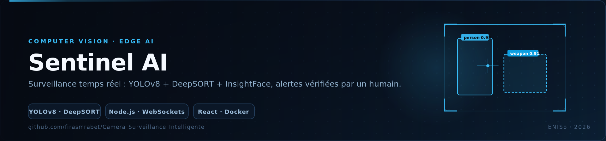
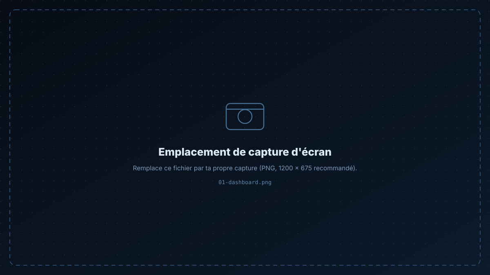
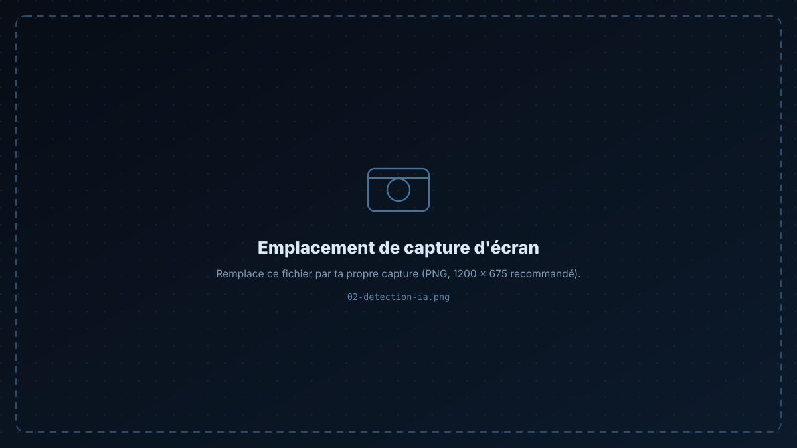

<p align="center">
  
</p>

<p align="center">
  
  
  
  
  
  
  
  
</p>

<h1 align="center">Sentinel AI</h1>

<p align="center">
Surveillance vidéo temps réel qui comprend <b>ce qui se passe</b> — pas seulement qu'il s'est passé quelque chose.<br/>
Armes, personnes inconnues, postures de vol et intrusions en zone interdite sont détectées, notées et transformées en <b>alertes vérifiées par un humain</b>.
</p>

<p align="center">
  <a href="#-ce-quil-détecte">Détection</a> ·
  <a href="#-architecture">Architecture</a> ·
  <a href="#-démarrage">Démarrage</a> ·
  <a href="#-api">API</a> ·
  <a href="#-performance">Performance</a>
</p>

---

## 📸 Captures

<p align="center">
  
  
</p>

---

## 🎯 Ce qu'il détecte

| Menace | Méthode de détection | Gravité |
|:--|:--|:--|
| **Armes** — couteau, arme de poing | YOLOv8 fine-tuné sur mesure | 🔴 CRITIQUE — appel police |
| **Personnes inconnues** | InsightFace vs. liste blanche | 🟠 ALERTE / CRITIQUE |
| **Posture de vol** — accroupissement, flexion en zone critique | YOLOv8-pose + analyse de zone | 🟠 ALERTE / CRITIQUE |
| **Gestes agressifs** — mains levées | YOLOv8-pose | 🟡 ALERTE |
| **Intrusion en zone interdite** | recouvrement de polygones | 🔴 CRITIQUE |
| **Flânage** — présence prolongée | historique de suivi DeepSORT | 🟡 ALERTE |
| **Plusieurs personnes la nuit** | heure + heuristique de comptage | 🟡 ALERTE |
| **Famille / personnes autorisées** | correspondance InsightFace | ✅ aucune alerte |

Chaque image reçoit un **score de menace multi-critères (0–100 %)**, et seules les alertes vérifiées par un humain sont escaladées — ce qui garde un taux de faux positifs exploitable en production.

---

## 🏗 Architecture

```
[ Caméra IP ] ──HTTP / MJPEG──▶ [ Serveur Node.js ]
                                      │  IPC
                                      ▼
                        [ Service IA Python ]
                    YOLOv8 · pose · armes · visages
                                      │
                                      ▼
                          [ Moteur de scoring ]
                                      │
                    ┌─────────────────┴─────────────────┐
                    ▼                                   ▼
          [ Tableau de bord React ]                  [ Email · SMS ]
             (WebSockets)                        (SMTP · Twilio)
```

### Pipeline de détection (par image)

1. **YOLOv8m** — détection d'objets (80 classes COCO)
2. **YOLOv8m-pose** — pose du corps, 17 points clés
3. **YOLOv8s-weapons** — arme de poing / couteau, fine-tuné sur mesure
4. **DeepSORT** — suivi multi-personnes avec identifiants persistants
5. **InsightFace `buffalo_l`** — reconnaissance faciale vs. liste blanche
6. **Scoring de menace** — score pondéré multi-critères → niveau de gravité

---

## 🚀 Démarrage

```bash
# 1 — paquets IA Python (une seule fois)
pip install mediapipe deep-sort-realtime insightface onnxruntime ultralytics

# 2 — dépendances Node
cd server && npm install
cd ../client && npm install

# 3 — backend (charge les modèles IA, ~30 s)
cd ../server && npm start

# 4 — frontend, dans un autre terminal
cd client && npm start
```

**Ou avec Docker :**

```bash
docker compose up --build
```

### Lancer la suite de tests IA

```bash
cd server && node test_pipeline.js
```

```
TEST 1  real persons ........ persons=6, poses=4, weapons=0, time=1990 ms
TEST 2  simulated weapon ..... score=100%  severity=critical
TEST 3  theft (crouch + zone)  score=55%   severity=warning
TEST 4  known family member ... score=0%    no alert  ✓
ALL TESTS PASSED
```

---

## 🔌 API

| Méthode | Endpoint | Description |
|:--|:--|:--|
| `POST` | `/api/ai/extract-embedding` | Extraire l'embedding de visage d'une image |
| `POST` | `/api/ai/test-frame` | Exécuter toute la chaîne de détection sur une image |

**Modules clés**

| Fichier | Rôle |
|:--|:--|
| `server/src/services/aiBridge.js` | pont IPC Node ↔ Python |
| `server/src/services/threatScoring.js` | scoring multi-critères |
| `server/src/services/unifiedAI.js` | orchestrateur de détection |
| `server/src/services/cameraManager.js` | boucle de capture |
| `ai/detector.py` | service IA Python (YOLOv8 + pose + armes + visages) |

---

## ⚡ Performance

| Métrique | Valeur |
|:--|:--|
| Inférence CPU | 1–2,5 s / image — suffisant pour une surveillance 24/7 |
| Inférence GPU | 50–100 ms / image (CUDA) |
| Mémoire | ~1,5 Go tous modèles chargés |
| Démarrage à froid | 20–30 s (chargement des modèles) |

### Modèles

`yolov8m.pt` (52 MB) · `yolov8m-pose.pt` (53 MB) · `weapons_yolov8s.pt` (22 MB) · `yolov5s.pt` (15 MB, backup) · `buffalo_l/` (InsightFace)

---

## ⚠️ Usage responsable

Ce projet traite des **données biométriques** (embeddings de visage) et vise une **surveillance privée et consentie** — tes propres locaux, avec information des personnes concernées. Vérifie la loi applicable au lieu de déploiement (en Tunisie : INPDP / *loi organique n° 2004‑63*). Aucune image ni embedding ne quitte ta machine.

---

<div align="center">

**Firas Mrabet** — Élève ingénieur en informatique appliquée @ ENISo

[GitHub](https://github.com/firasmrabet) · [LinkedIn](https://www.linkedin.com/in/firas-mrabet-98779934b) · [Portfolio](https://firas-mrabet-portfoliowebsite.vercel.app) · [Email](mailto:firasmrabet1603@gmail.com)

</div>
